# humanizer-tests

Testing how different models and humanizer skills rewrite the same text, starting with the [wilson-humanizer](https://github.com/WilsonXY/kook/tree/main/writing/wilson-humanizer) skill, and how the results score on AI detectors.

## Test 1: AI-Assisted Writing guidelines (2026-10-19)

### Results

AI score from each detector (higher means the detector thinks it's more likely AI-written):

| Model | [ZeroGPT](https://www.zerogpt.com/) | [Grammarly](https://www.grammarly.com/ai-detector) | [QuillBot](https://quillbot.com/ai-content-detector) | [GPTZero](https://gptzero.me/) | Average |
| --- | --- | --- | --- | --- | --- |
| gemini-3.8-flash-high | **0%** | 81% | **11%** | 100% | **48.0%** |
| gpt-6.1-sol-high | 95.8% | 89% | 58% | 100% | 85.7% |
| opus-5.5-high | 100% | **48%** | 23% | 100% | 67.8% |

Bold marks the lowest score in each column. GPTZero scored all three at 100%.

| Model | Output | Length |
| --- | --- | --- |
| gemini-3.8-flash-high | [outputs/gemini-3.8-flash-high.md](outputs/gemini-3.8-flash-high.md) | 2,989 chars, 475 words, 5 paragraphs |
| gpt-6.1-sol-high | [outputs/gpt-6.1-sol-high.md](outputs/gpt-6.1-sol-high.md) | 3,032 chars, 502 words, 9 paragraphs |
| opus-5.5-high | [outputs/opus-5.5-high.md](outputs/opus-5.5-high.md) | 3,456 chars, 588 words, 9 paragraphs |

All three stayed well inside the 15,000 character limit and turned the bullet lists into paragraphs as asked.

#### What each detector said

- **ZeroGPT:** Gemini was "Human written" at 0%. GPT (95.8%) and Opus (100%) were both "AI/GPT Generated".
- **Grammarly:** Gemini 81%, GPT 89%, Opus 48%. Opus was the only output Grammarly put under 50%.
- **QuillBot:** Gemini 11%, GPT 58%, Opus 23%. QuillBot rated "AI-refined" at 0% for all three, so the whole score is "AI-generated" and the rest is "human-written".
- **GPTZero:** all three were 100% AI, 0% mixed and 0% human, with "highly confident" verdicts. Gemini and GPT were checked with Basic Scan and Opus with Advanced Scan (see limitations).

### What each model did

**gemini-3.8-flash-high** rewrote the guide as a first-person student story. It dropped the title, all headings and the quoted reusable prompt. It also added experiences that aren't in the source text: running group writeups through ZeroGPT and Turnitin "last term", a distributed systems project, weekly standups, a tutor, and GitHub commit logs. It added a new claim too ("markers can tell right away when sentences sound forced"). The source text explicitly says not to invent facts, examples or experiences, so this output breaks the guidance it's meant to be presenting.

**gpt-6.1-sol-high** kept the content and order of the source, written in second person. It renamed the title to "A Practical Guide to AI-Assisted Writing", removed the section headings, and kept the reusable prompt as a quoted paragraph. Nothing was invented.

**opus-5.5-high** stayed closest to the source. It kept the original title, covered every point in order, and kept the reusable prompt as a blockquote. Nothing was invented. It was also the longest of the three.

### Takeaways

- **The detectors disagree a lot.** The same Gemini text scored anywhere from 0% to 100% depending on the detector. Opus ranged from 23% to 100%. A single detector score doesn't tell you much on its own.
- **No output passed everywhere.** GPTZero flagged all three at 100%. Every output was rated above 80% AI by at least two of the four detectors.
- **The detectors don't agree on which output is "most human".** Gemini scored lowest on ZeroGPT and QuillBot, Opus scored lowest on Grammarly, and GPTZero gave them all the same score.
- **GPT scored high on every detector.** At 58% to 100%, it had the highest average of the three.
- **A low score doesn't mean a better rewrite.** Gemini had the lowest average, but it got there by changing the format and making up personal experiences. If the text has to stay accurate to the original, those anecdotes would need to come out.
- Guideline-style content (instructions, lists of principles, a prompt template) is predictable by nature. A faithful rewrite of it is likely to keep reading as AI to most detectors.

### Limitations

- One run per model, one source text, and one scan per detector. Running the same prompt again could give a different output and different scores.
- The outputs were checked with their markdown syntax still in them. The GPT and Opus outputs have a `#` title (Opus also has a `>` blockquote), while the Gemini output is plain paragraphs. That difference might have affected the scores too.
- For ZeroGPT the outputs were pasted in. For Grammarly, QuillBot and GPTZero they were typed into each site's text box from the same files. The text was the same either way.
- QuillBot's word counts were 501 for GPT and 586 for Opus instead of 502 and 588, because QuillBot doesn't count the `#` and `>` markers as words. The text itself was complete.
- GPTZero scan types aren't matched. Gemini and GPT used the free Basic Scan. Opus used Advanced Scan, which was the default once signed in, and that used up the account's free Advanced Scans, so the other two couldn't be rerun on Advanced. All three still came out at 100%.
- Grammarly's Gemini result came from a signed-out scan. A signed-in rerun hit the daily free limit, but the 81% showing behind the limit message matched. An earlier signed-out GPT attempt showed a stale 81% and was thrown out. The 89% in the table is from a fresh signed-in scan.
- The source text itself says no detector is perfectly reliable, and these scores should be read that way.

### Screenshots

Each detector has its own folder under [screenshots/](screenshots/), with one file per model.

#### ZeroGPT

| gemini-3.8-flash-high: 0% | gpt-6.1-sol-high: 95.8% | opus-5.5-high: 100% |
| --- | --- | --- |
| 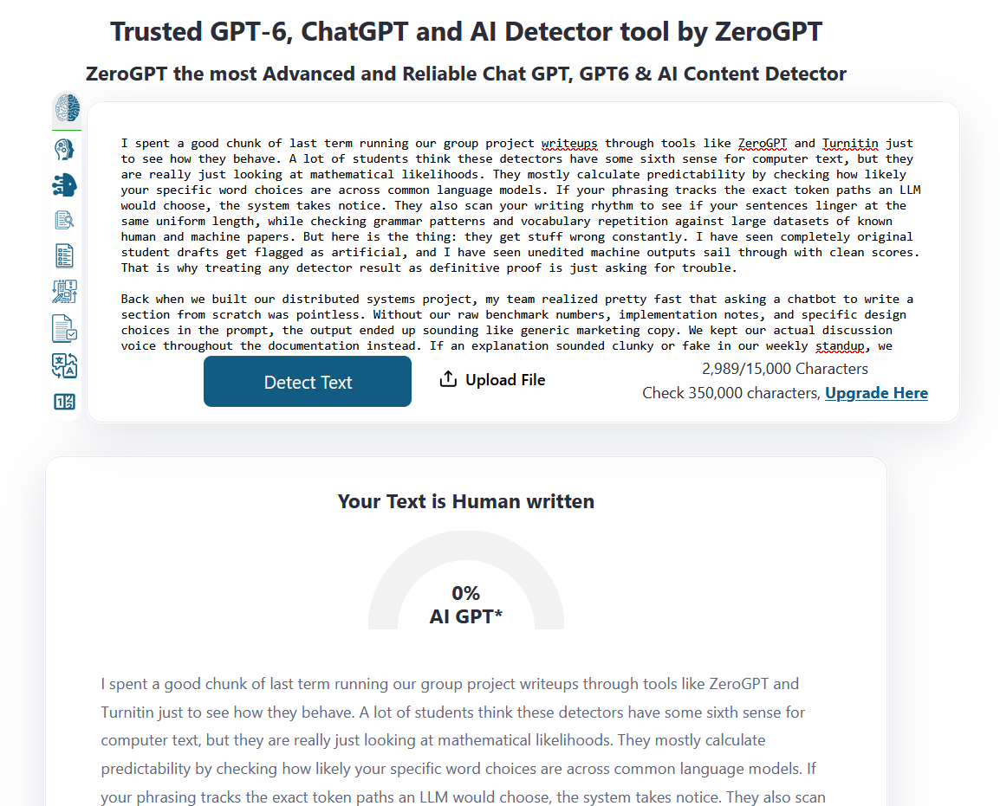 | 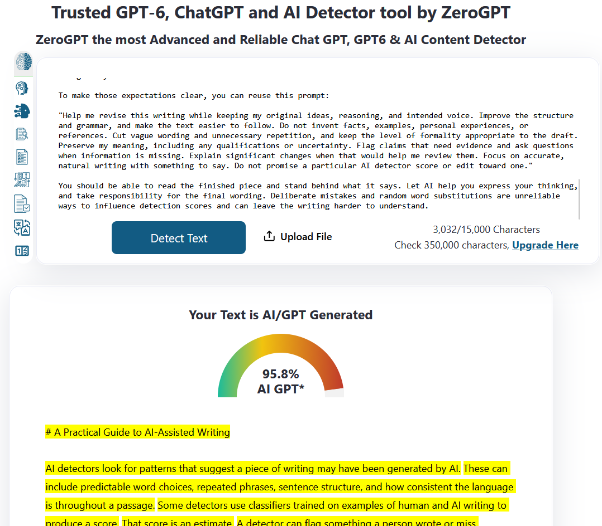 | 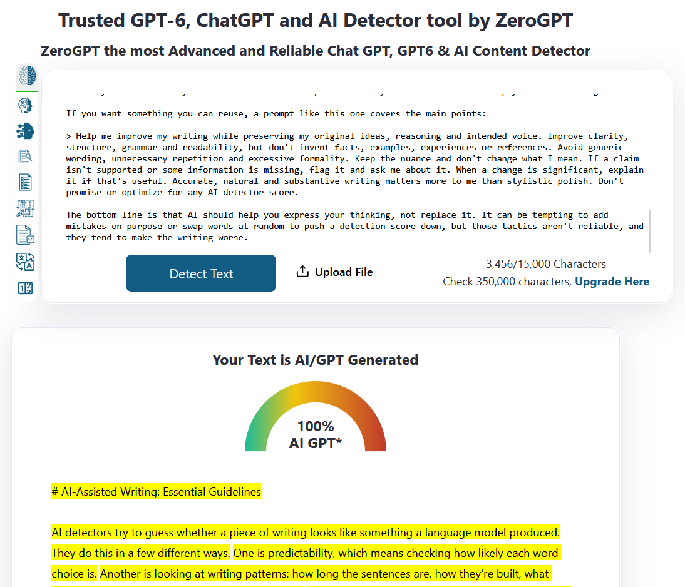 |

In the GPT and Opus screenshots, ZeroGPT highlights almost every sentence in yellow, starting with the `#` title line.

#### Grammarly

| gemini-3.8-flash-high: 81% | gpt-6.1-sol-high: 89% | opus-5.5-high: 48% |
| --- | --- | --- |
| 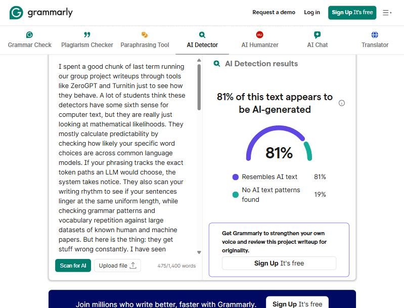 | 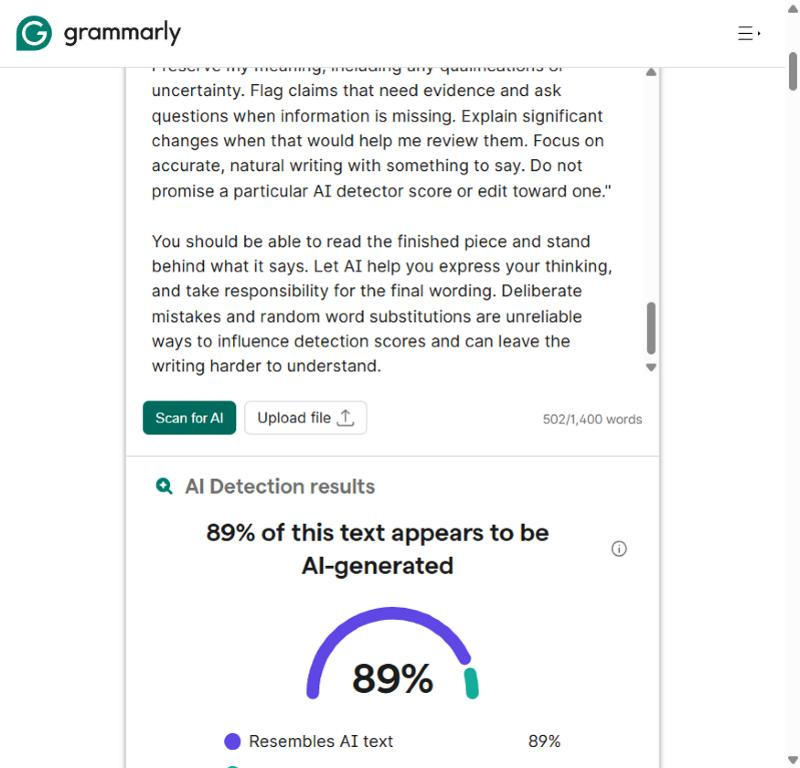 | 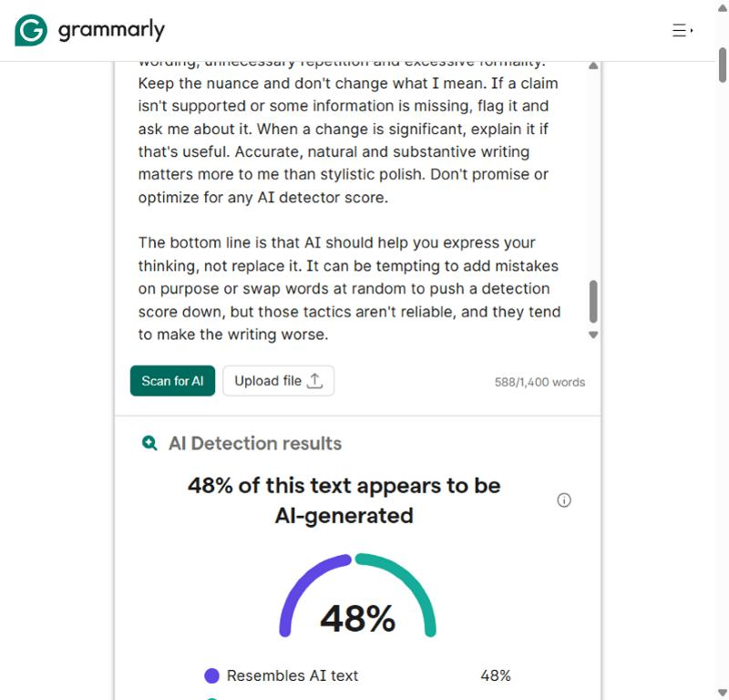 |

#### QuillBot

| gemini-3.8-flash-high: 11% | gpt-6.1-sol-high: 58% | opus-5.5-high: 23% |
| --- | --- | --- |
| 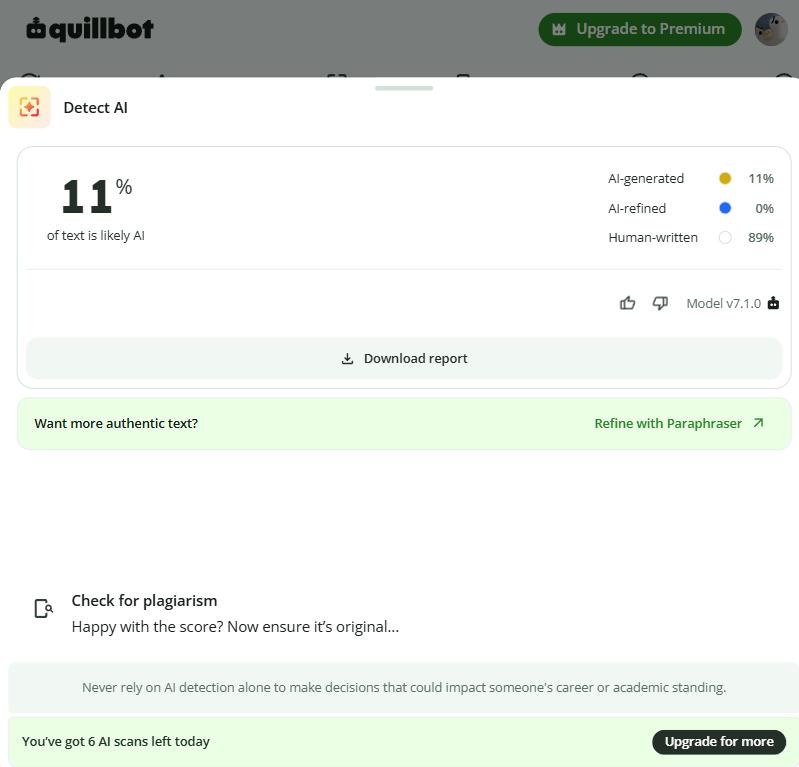 | 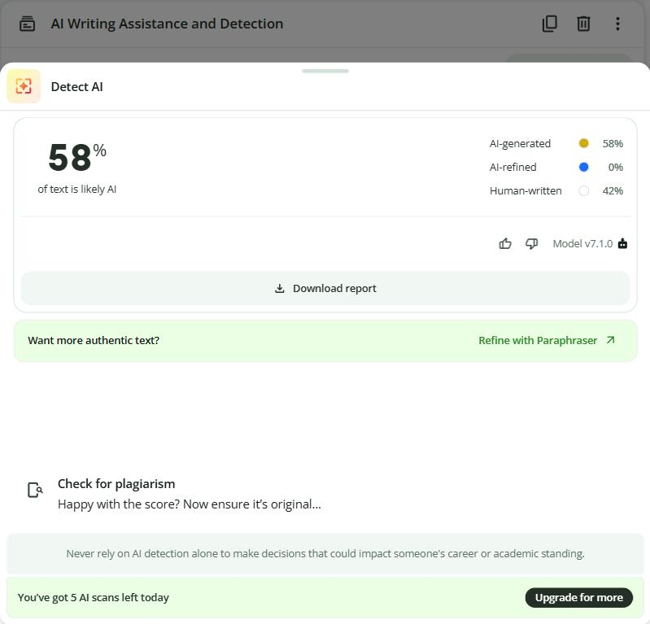 | 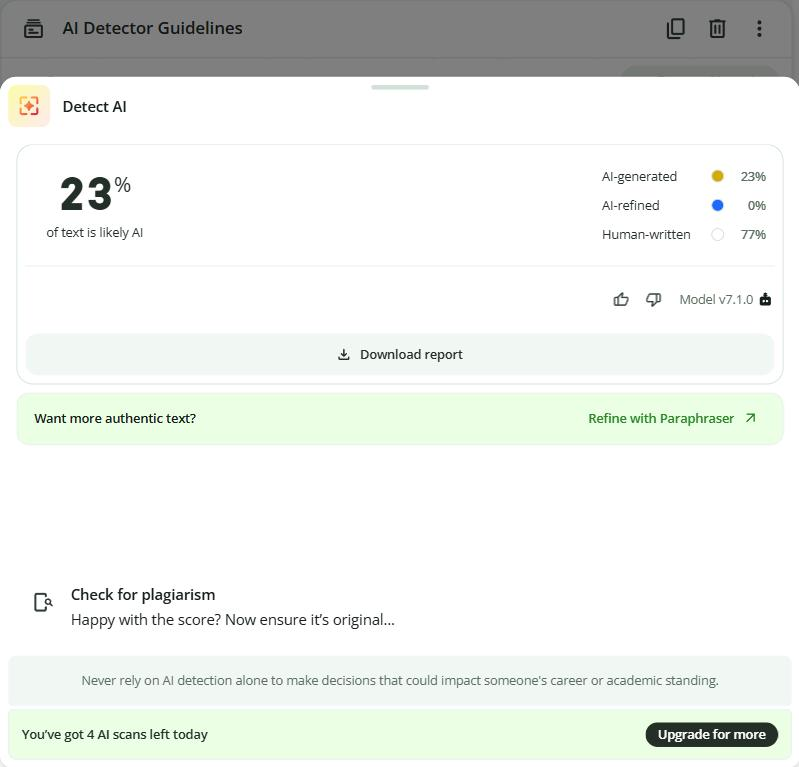 |

#### GPTZero

| gemini-3.8-flash-high: 100% | gpt-6.1-sol-high: 100% | opus-5.5-high: 100% |
| --- | --- | --- |
| 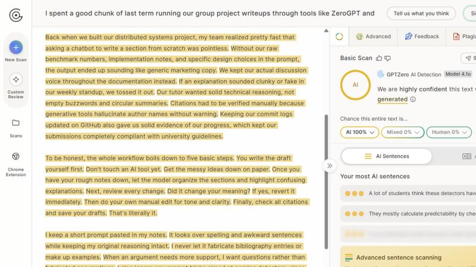 | 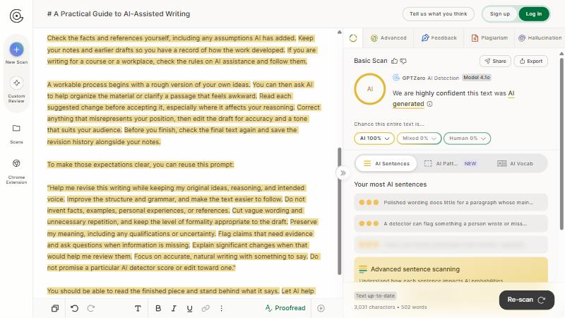 | 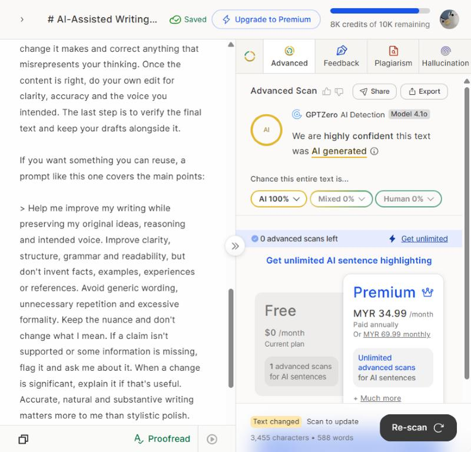 |

### Prompt used

Each model got the same prompt:

````text
MUST install this skill:
https://github.com/WilsonXY/kook/tree/main/writing/wilson-humanizer

humanize this text into paragraphs form into a md file, within 15000 Characters:
# AI-Assisted Writing: Essential Guidelines

## 1. How AI detectors work

AI detectors estimate whether writing resembles AI-generated text by analyzing:

- Predictability: How likely the word choices are.
- Writing patterns: Sentence length, structure, vocabulary, and repetition.
- Language patterns: Grammar, phrasing, and consistency.
- Classifier scores: Patterns learned from examples of human and AI writing.

Important: No detector is perfectly reliable. Human writing can be flagged, and AI writing can go undetected.

## 2. Principles for AI-assisted writing

1. Start with your own ideas. Provide your own arguments, opinions, notes, and examples.
2. Preserve your voice. Keep wording and tone appropriate to how you naturally communicate.
3. Prioritize substance. Make arguments specific, relevant, logical, and supported by evidence.
4. Avoid generic writing. Remove repetitive explanations, empty transitions, and vague claims.
5. Verify everything. Check facts, citations, and AI-generated assumptions.
6. Retain your drafts. Keep notes and revision history as evidence of your writing process.
7. Follow applicable rules. Respect any academic or professional policies on AI assistance.

## 3. Recommended workflow

- Step 1: Write your own rough ideas.
- Step 2: Ask AI to organize, clarify, and improve them.
- Step 3: Review each change and correct anything that misrepresents your thinking.
- Step 4: Edit for clarity, accuracy, and your intended voice.
- Step 5: Verify the final text and retain your drafts.

## 4. Reusable prompt

Help me improve my writing while preserving my original ideas, reasoning, and intended voice.

- Improve clarity, structure, grammar, and readability.
- Do not invent facts, examples, experiences, or references.
- Avoid generic wording, unnecessary repetition, and excessive formality.
- Preserve nuance and do not change my intended meaning.
- Flag unsupported claims and ask questions when information is missing.
- Explain significant changes when useful.

Prioritize accurate, natural, substantive writing over stylistic polish. Do not guarantee or optimize for any AI detector score.

Bottom line: Let AI help you express your thinking, not replace it. Don't deliberately introduce mistakes or randomly change words to manipulate detection scores; these tactics are unreliable and can make the writing worse."
````

Each output was then run through the four detectors above to get the scores.

## Test 2: wilson-humanizer vs blader/humanizer (2026-10-20)

Same source text and the same model as Test 1, but this time each output was produced with a different skill: [wilson-humanizer](https://github.com/WilsonXY/kook/tree/main/writing/wilson-humanizer) and [blader/humanizer](https://github.com/blader/humanizer), the most-starred humanizer skill on GitHub (about 58.7k stars at the time of the test).

| Skill | Version used |
| --- | --- |
| wilson-humanizer | [`33e9633`](https://github.com/WilsonXY/kook/tree/33e9633aeb8526db42f4017d3ea936f9cfe8bdb8/writing/wilson-humanizer) (2026-10-20) |
| blader/humanizer | v3.1.0, [`8c307f3`](https://github.com/blader/humanizer/tree/8c307f367c91bd974002f10f2be2965d642c13df) (2026-10-16) |

### Results

AI score from each detector (higher means the detector thinks it's more likely AI-written):

| Skill | [ZeroGPT](https://www.zerogpt.com/) | [Grammarly](https://www.grammarly.com/ai-detector) | [QuillBot](https://quillbot.com/ai-content-detector) | [GPTZero](https://gptzero.me/) | Average |
| --- | --- | --- | --- | --- | --- |
| wilson-humanizer | 96.8% | **38%** | **38%** | 100% | **68.2%** |
| blader/humanizer | **85.3%** | 91% | 47% | 100% | 80.8% |

Bold marks the lower score in each column. GPTZero scored both at 100%.

| Skill | Output | Length |
| --- | --- | --- |
| wilson-humanizer | [outputs/test-2/wilson-humanizer-opus-5.5-high.md](outputs/test-2/wilson-humanizer-opus-5.5-high.md) | 3,869 chars, 648 words, 11 paragraphs |
| blader/humanizer | [outputs/test-2/blader-humanizer-opus-5.5-high.md](outputs/test-2/blader-humanizer-opus-5.5-high.md) | 2,612 chars, 415 words, 7 paragraphs |

Both stayed well inside the 15,000 character limit and turned the bullet lists into paragraphs as asked.

#### What each detector said

- **ZeroGPT:** both were "AI/GPT Generated". wilson 96.8%, blader 85.3%. This is the only detector where blader scored lower.
- **Grammarly:** wilson 38%, blader 91%. The biggest gap in the test, and wilson's 38% is lower than any Grammarly score in Test 1 (best was 48%).
- **QuillBot:** wilson 38% (62% human-written), blader 47% (53% human-written). "AI-refined" was 0% for both, as in Test 1.
- **GPTZero:** both 100% AI, 0% mixed and 0% human, with "highly confident" verdicts. Both were checked with Advanced Scan (Model 4.1o).

### What each skill did

**wilson-humanizer** kept the original title and all four section headings, and added a fifth "Bottom line" heading for the closing paragraph. It covered every point in order and kept the reusable prompt as a near word-for-word blockquote. It didn't invent any facts or experiences, but it did add a few sentences of its own that aren't in the source: that a detector score "shouldn't be read as proof of who wrote something", that you should rewrite an AI suggestion "you would never actually say", "before you open any tool", "if anyone asks about it", and a paragraph explaining that the prompt's last line "is there on purpose". The source asks not to invent examples or claims, so these are small departures from it, though nothing like the made-up experiences in Test 1's Gemini output.

**blader/humanizer** stayed closest to the source content. It rewrote the title and headings in sentence case (and renamed two of them, e.g. "A workflow that keeps the ideas yours"), dropped the "Bottom line" label and folded that closing line into the last paragraph, and kept the reusable prompt as a slightly condensed blockquote. Nothing was added beyond a framing line before the prompt. It was the shorter of the two by about a third, and reads denser, with several points packed into each sentence.

### Takeaways

- **wilson-humanizer scored lower (more human) on 2 of 4 detectors, blader on 1 of 4, and they tied on GPTZero.** wilson's average was 68.2% against blader's 80.8%.
- **The gap is mostly Grammarly.** Take Grammarly out and the averages are 78.3% (wilson) vs 77.4% (blader), basically even.
- **GPTZero still flags everything.** Across both tests, all five outputs scored 100% on GPTZero.
- **The trade-off is fidelity.** blader stayed more faithful to the source; wilson's rewrite was looser and longer, and added a few sentences of commentary. Some of what helped wilson's scores might be that extra, less predictable material.
- **wilson-humanizer's average on Opus barely moved.** Test 1's opus-5.5-high output averaged 67.8%, this one 68.2%, though the per-detector scores moved a lot (ZeroGPT 100% → 96.8%, Grammarly 48% → 38%, QuillBot 23% → 38%), and the skill was updated between the two tests.

### Limitations

- One run per skill, one source text, one model and one scan per detector. Running the same prompt again could give a different output and different scores.
- Both outputs were made by Claude Opus 5.5 on high effort, each in a fresh session that could only see its own skill, so neither run was influenced by the other skill. The only difference in the prompt was the skill URL.
- The wilson-humanizer skill was changed on 2026-10-20, after Test 1, so the Test 1 opus-5.5-high output and this one may not come from the same version of the skill.
- As in Test 1, the outputs were scanned with their markdown (`#`, `##` and `>`) still in them.
- ZeroGPT and Grammarly were run signed-out from a script in a headless browser, pasting each file as-is. The first ZeroGPT attempt for blader crashed before its score was recorded and was thrown out; the 85.3% is from the rerun. QuillBot and GPTZero block automated browsers (Cloudflare and hCaptcha), so those two were run by hand in a normal browser, signed in.
- Both GPTZero scans were done in the same document, so the file name at the top of both screenshots is the blader one. The text in the editor shows which output each scan was for. The character counts GPTZero shows (2,600 and 3,852) are a little under the files' (2,612 and 3,869), probably because blank lines were dropped when pasting.
- QuillBot counted 409 and 641 words instead of 415 and 648, since it doesn't count the markdown markers as words.

### Screenshots

Test 2 screenshots sit in the same detector folders as Test 1, prefixed with `test-2-`.

#### ZeroGPT

| wilson-humanizer: 96.8% | blader/humanizer: 85.3% |
| --- | --- |
| 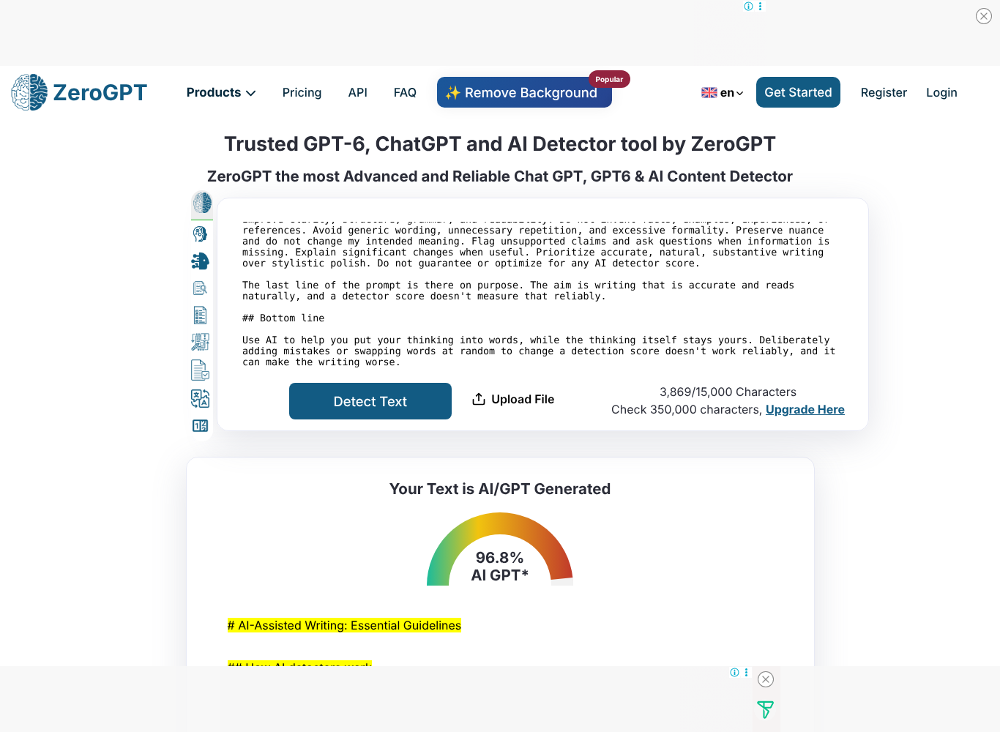 | 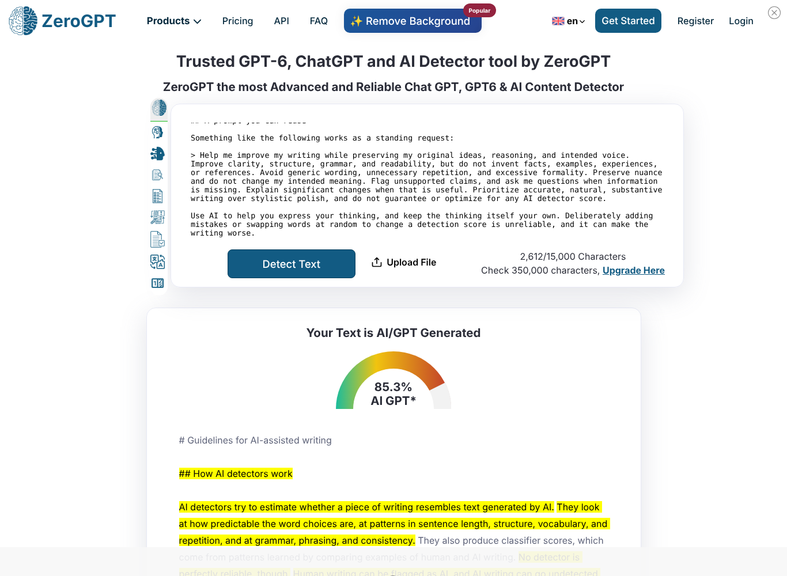 |

#### Grammarly

| wilson-humanizer: 38% | blader/humanizer: 91% |
| --- | --- |
| 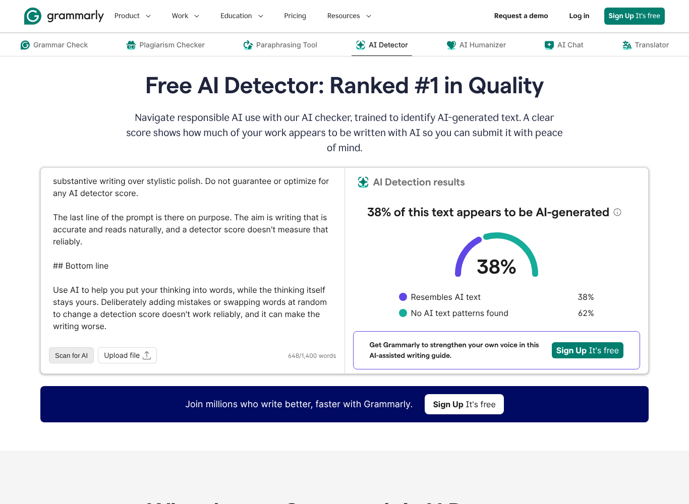 | 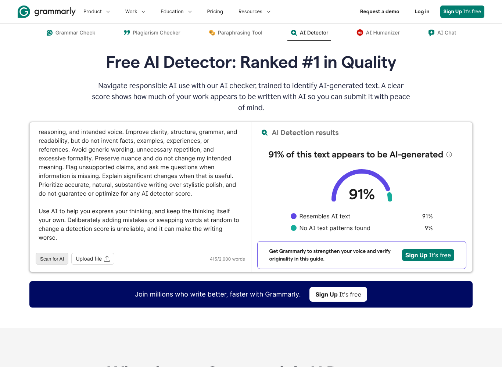 |

#### QuillBot

| wilson-humanizer: 38% | blader/humanizer: 47% |
| --- | --- |
| 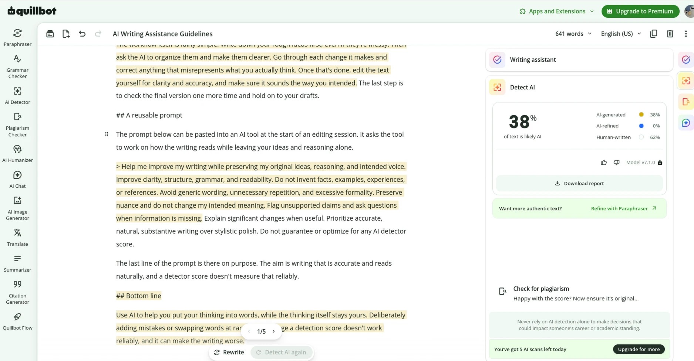 | 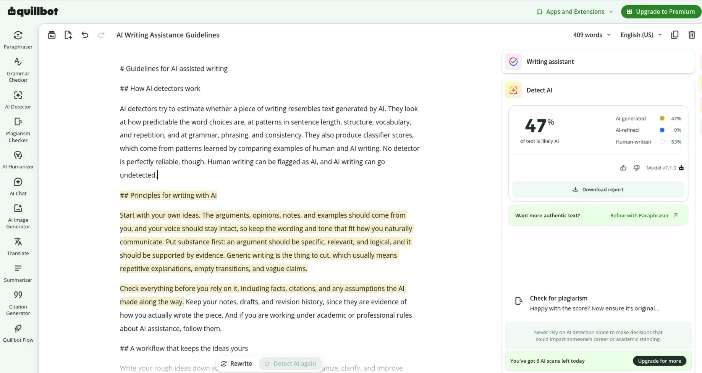 |

#### GPTZero

| wilson-humanizer: 100% | blader/humanizer: 100% |
| --- | --- |
| 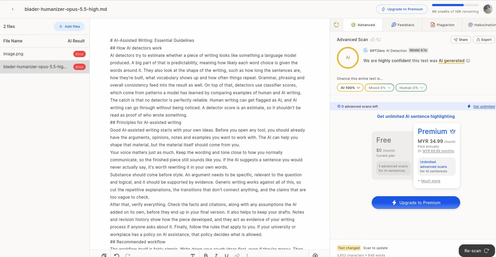 | 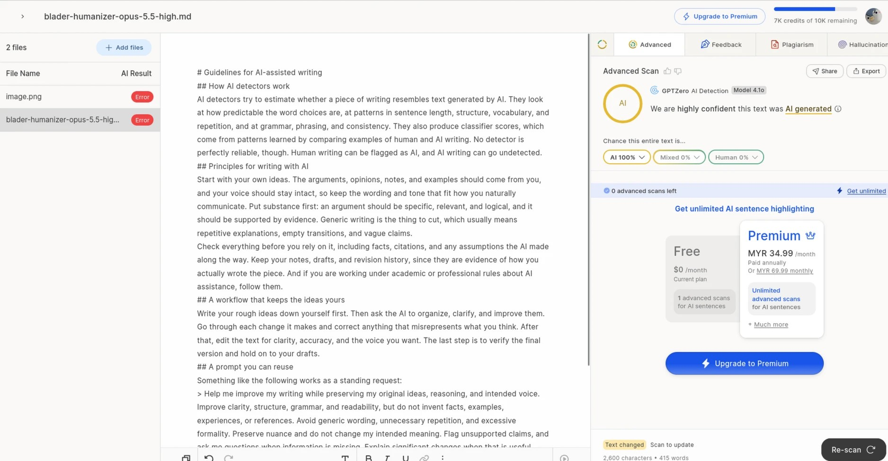 |

### Prompt used

The same prompt as Test 1, with only the skill URL changed. For wilson-humanizer it was identical to Test 1. For blader/humanizer the first two lines were:

```text
MUST install this skill:
https://github.com/blader/humanizer
```
